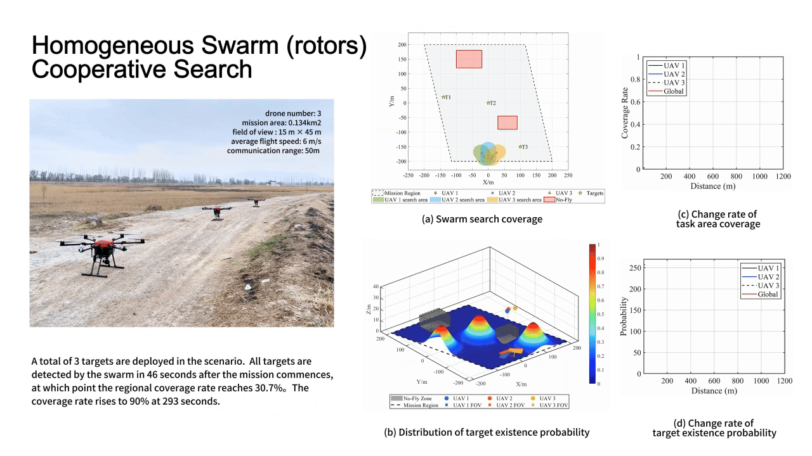
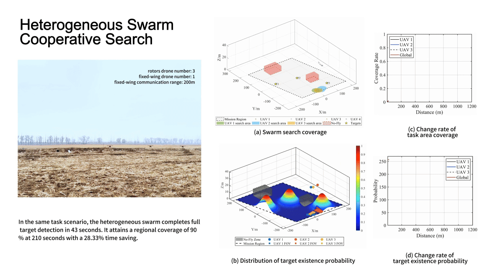
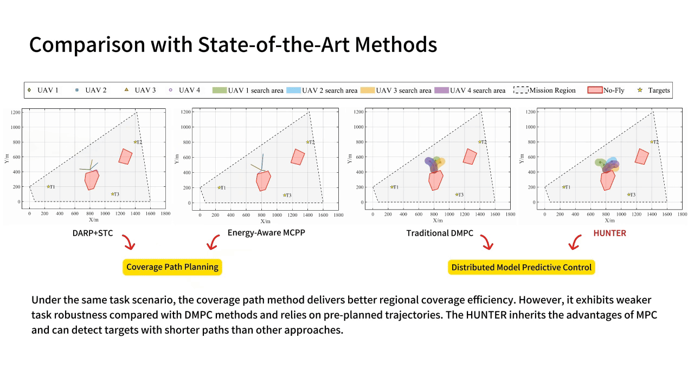

# HUNTER

**HUNTER** is a heterogeneous multi-UAV cooperative search framework that combines fixed-wing communication relays with multirotor search UAVs. It integrates decentralized Genetic Algorithm-based Distributed Model Predictive Control (GA-DMPC), information-driven event-triggered replanning, and compact inter-UAV communication to improve search efficiency while accounting for motion and communication constraints.

HUNTER achieves shorter target-discovery distances than conventional cooperative planning approaches in simulation experiments.


<p align="center">
  
  
</p>

HUNTER was also validated through outdoor flight experiments with heterogeneous UAV teams.

<p align="center">
  
</p>


Please cite our paper if you use this project in your research:

```bibtex
@ARTICLE{hunter,
  author={Wei, Yunbo and Liu, Yuxin and Liu, Zhenchang and Ren, Xuefeng},
  journal={IEEE Internet of Things Journal},
  title={HUNTER: Heterogeneous UAV Swarm Ad Hoc Network Cooperative Search System},
  year={2026},
  note={Accepted for publication}
}
```


## Table of Contents

- [HUNTER](#hunter)
  - [Table of Contents](#table-of-contents)
  - [Quick Start](#quick-start)
  - [Exploring Different Scenarios](#exploring-different-scenarios)
  - [Acknowledgements](#acknowledgements)

## Quick Start

**Test Environment**

- Ubuntu 20.04
- ROS 2 Foxy
- C++ 17

**Clone Code**

```bash
mkdir -p ~/hunter_ws/src
cd ~/hunter_ws/src
git clone https://github.com/LiuZhenchang/HUNTER
```

**Build**

```bash
cd ~/hunter_ws
source /opt/ros/foxy/setup.bash
colcon build --symlink-install
```


## Exploring Different Scenarios

Run the following commands to launch the RViz simulation:

```
cd ~/hunter_ws
source install/setup.bash
ros2 launch swarm.launch.py
```

You can modify the parameters in `swarm.launch.py` to evaluate different target distributions, mission areas, and numbers of UAVs.

Algorithm parameters, including DMPC weights and field of view (FOV), can be configured in `single.launch.py`.


## Acknowledgements

We would like to express our gratitude to the following open-source projects, which have provided significant support for our work:

[openGA](https://github.com/Arash-codedev/openGA)

[SO3 Controller](https://github.com/HKUST-Aerial-Robotics/Fast-Planner/tree/master/uav_simulator/so3_control)

We use **openGA** for genetic algorithm-based trajectory optimization and the **SO3 Controller** for multirotor trajectory tracking.